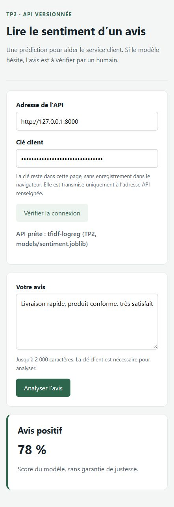
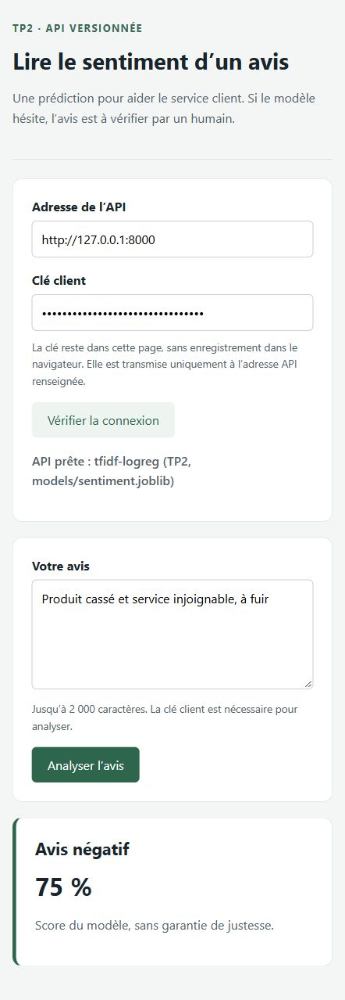
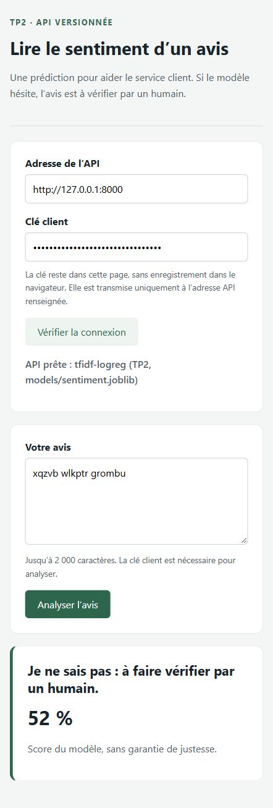
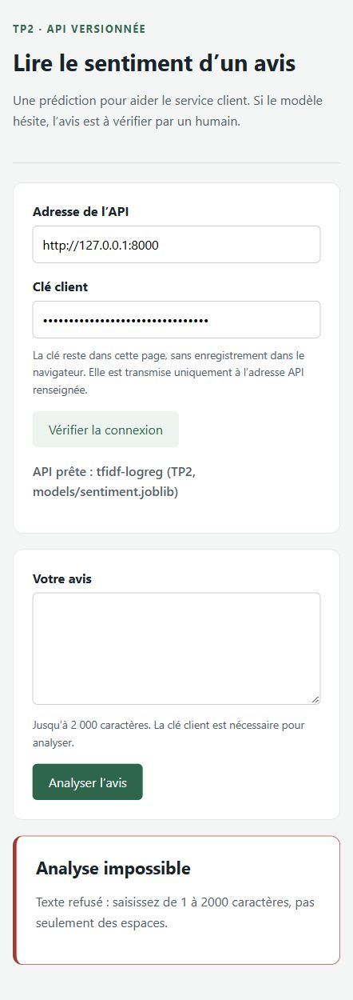
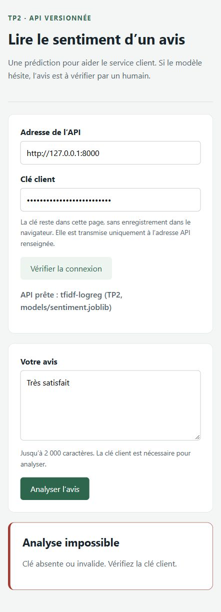
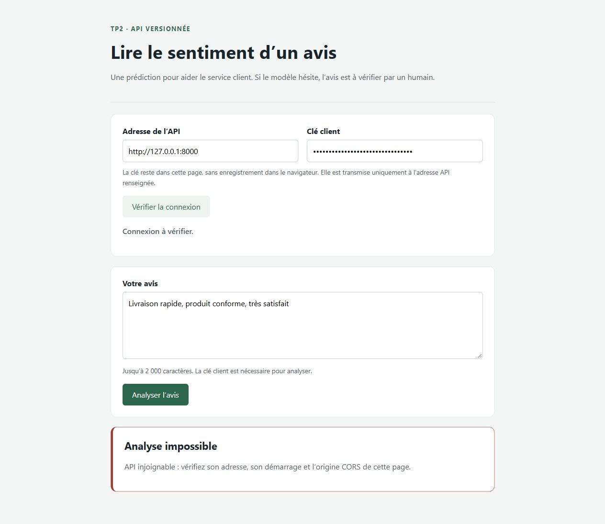

# TP2 du manuel V1.1 — API protégée et client web

## Périmètre et provenance

Implémentation du TP2 décrit pages 28 à 35 du manuel V1.1, à la suite du TP1 déjà validé. Le nouveau `kit-tp2.zip` n'étant pas présent dans les ressources locales, les modules `/v1`, le client et leurs tests ont été écrits pour ce dépôt à partir du contrat décrit dans le manuel ; ce document ne prétend pas qu'un kit officiel a été appliqué.

Les nouveaux fichiers sont `api/securite.py`, `api/v1.py`, `web/index.html`, `web/client.js` et les tests associés. Le modèle et le jeu d'or du TP1 sont conservés. L'activité complémentaire Java présentée page 51 est réservée à cette activité ultérieure ; elle n'est pas incluse dans ce TP2.

## Contrat et droits

| Route | Accès | Résultat |
| --- | --- | --- |
| GET /health et GET /v1/health | Public | Santé du modèle |
| POST /v1/predict | Clé client ou admin | POSITIVE, NEGATIVE ou INDETERMINE et score |
| GET /v1/modele | Clé admin | Nom, seuil d'abstention et métriques |
| POST /predict | Historique public, déprécié | Même prédiction ; en-têtes Deprecation et Link |

Les clés locales, de 32 caractères, sont générées dans `.env` par `scripts/configurer_tp2.py`. Ce script conserve un fichier déjà existant et n'affiche jamais les clés. L'API valide `API_KEYS` au démarrage ; une clé courte, un format incorrect, un doublon ou un rôle inconnu empêchent le démarrage. Sans clé configurée, les routes protégées refusent l'accès.

L'authentification utilise `X-API-Key` et une comparaison en temps constant ; l'autorisation distingue client et admin. Les messages d'erreur ne recopient pas les clés. Les journaux de prédiction contiennent le verdict et le score, pas le texte saisi.

## Appels réellement exécutés

Les [réponses HTTP enregistrées](controles/tp2-v11-http.json) ne contiennent aucune clé.

| Essai | Statut | Code ou résultat |
| --- | --- | --- |
| Santé publique | 200 | OK |
| Prédiction sans clé | 401 | NON_AUTHENTIFIE |
| Prédiction avec clé client | 200 | POSITIVE, 0.777 |
| Trois espaces avec clé valide | 422 | ENTREE_INVALIDE, champ body.text |
| Métadonnées avec clé client | 403 | ACCES_REFUSE |
| Métadonnées avec clé admin | 200 | Seuil 0.60 et métriques |
| Ancien POST /predict | 200 | Deprecation: true, Link vers /v1/predict |
| Preflight depuis localhost:5500 | 200 | Origine autorisée |
| Preflight depuis localhost:5600 | 400 | Origine refusée |

Sous `/v1`, une erreur a toujours la forme `{"erreur":{"code":"...","message":"...","champs":[]}}`. Le client reconnaît le code stable ; le message lisible peut évoluer. Les erreurs historiques restent au format `detail`.

## Client web et expérience CORS

Le client a été essayé contre le serveur réel sur `127.0.0.1:8000`, depuis la page servie sur `127.0.0.1:5500` :

- Avis positif : 78 % ; avis négatif : 75 %.
- Mots inventés : « Je ne sais pas : à faire vérifier par un humain », 52 %.
- Espaces : message de refus du texte.
- Clé incorrecte : message de clé absente ou invalide.
- La même page servie sur 5600 : message API injoignable, le navigateur bloquant l'échange CORS.

La preuve CORS combine la capture du message dans le navigateur et le preflight HTTP 400 enregistré ; elle ne montre pas une capture des outils réseau. L'API est restée active pendant cet essai. Un appel depuis Python ou curl n'est pas soumis à la politique CORS du navigateur et peut réussir avec une clé valide malgré cette origine refusée.

La clé n'est pas stockée en localStorage ; le champ est masqué sur les captures. Elle est envoyée à l'adresse API explicitement renseignée, jamais ajoutée à l'URL. Le résultat est affiché avec `textContent`.













## Qualité et tests

| Contrôle | Résultat observé |
| --- | --- |
| Nouveaux tests /v1, intégration et limites | 44 tests |
| Suite complète et couverture | 112 passed, 1 xfailed, 1 warning in 16.12s |
| Couverture des 6 modules API | 100 %, sans exclusion de lignes |
| Ruff | All checks passed! |
| mypy api | Success: no issues found in 6 source files |
| Client web Node | 12 tests réussis, aucun échec |

Preuves : [couverture et pytest](controles/tp2-v11-couverture.txt), [Ruff](controles/tp2-v11-ruff.txt), [mypy](controles/tp2-v11-mypy.txt), [tests web](controles/tp2-v11-client-web.txt).

Les tests couvrent les bornes et les blancs Unicode (y compris des exemples générés par Hypothesis), les rôles, les formats d'erreur, l'absence de modèle et les pannes. Un test lance réellement Uvicorn sur un port temporaire puis l'arrête. Un autre confirme le refus de démarrage avec un chemin de modèle absent sans renommer le modèle de travail. Les clés fictives propres aux tests remplacent la configuration locale.

Les retouches aux tests fournis auparavant se limitent au tri des imports et au renommage de la variable `l` en `line` ; leurs assertions et seuils ne sont pas affaiblis. Ruff a aussi retiré un import inutilisé et trié deux imports du notebook. Le `xfailed` du jeu d'or reste l'erreur connue du TP1. L'avertissement AnyIO/Starlette est conservé dans la sortie réelle.

Le workflow CI installe les dépendances nécessaires, entraîne le modèle, puis lance Ruff, mypy, pytest avec le seuil de couverture de 95 %, et les tests Node. Le résultat de publication sera renseigné après observation.

## Lancer depuis PowerShell

Dans le dossier du projet, pour installer les outils et créer la configuration locale :

```powershell
. .\.venv\Scripts\Activate.ps1
$env:Path = "C:\Program Files\Git\cmd;$env:Path"
python -m pip install -r requirements.txt -r requirements-dev.txt
python scripts/configurer_tp2.py
python src/make_demo.py
python src/train.py
```

Terminal 1 :

```powershell
python -m uvicorn api.main:app --reload
```

Terminal 2 :

```powershell
python -m http.server 5500 --bind 127.0.0.1 --directory web
```

Ouvrir `http://127.0.0.1:5500`, puis copier la valeur `API_KEY` du `.env` local dans le champ clé client. Dans Swagger (`http://127.0.0.1:8000/docs`), le bouton Authorize sert à fournir la clé. Ne pas joindre le `.env` aux captures ou aux commits.

Contrôles reproductibles :

```powershell
python -m ruff check .
python -m mypy api
python -m pytest -q --cov=api --cov-report=term-missing --cov-fail-under=95
node --test web/client.test.mjs
```

## Références techniques consultées

- [Gestion des erreurs FastAPI](https://fastapi.tiangolo.com/tutorial/handling-errors/).
- [CORS dans FastAPI](https://fastapi.tiangolo.com/tutorial/cors/).
- Manuel V1.1 fourni par l'équipe, pages 28 à 35.
